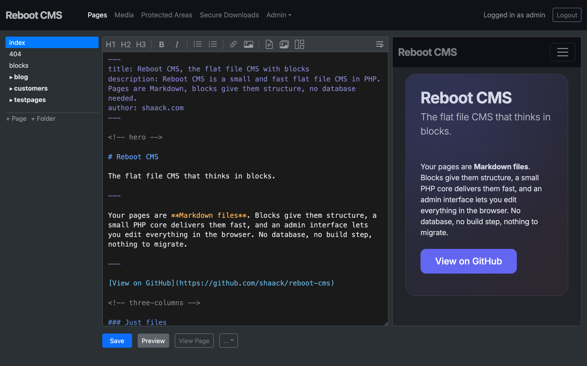
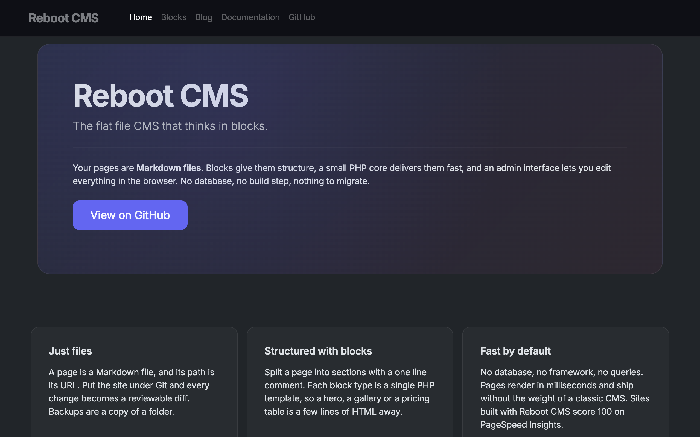
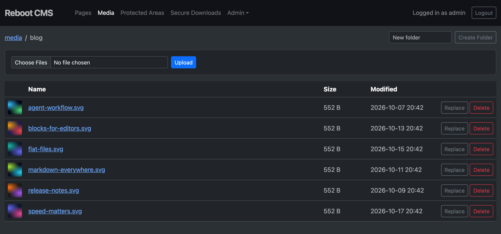
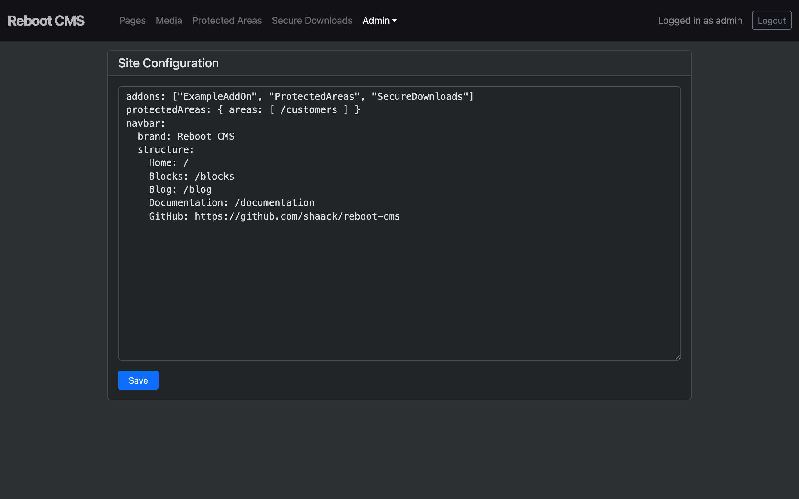
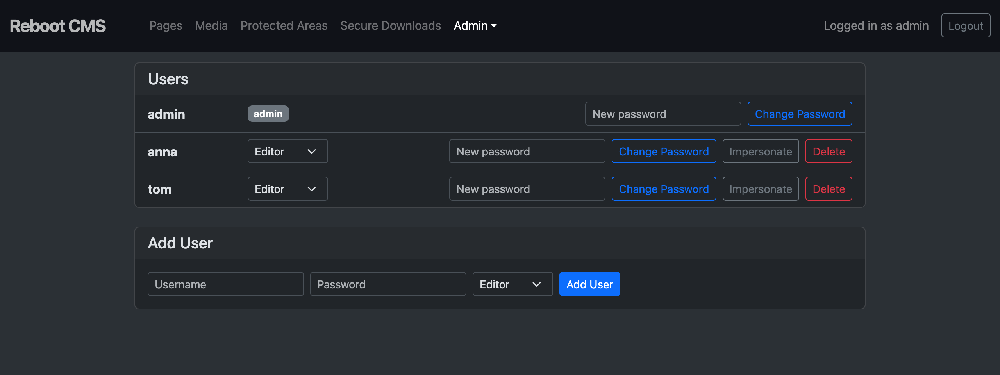
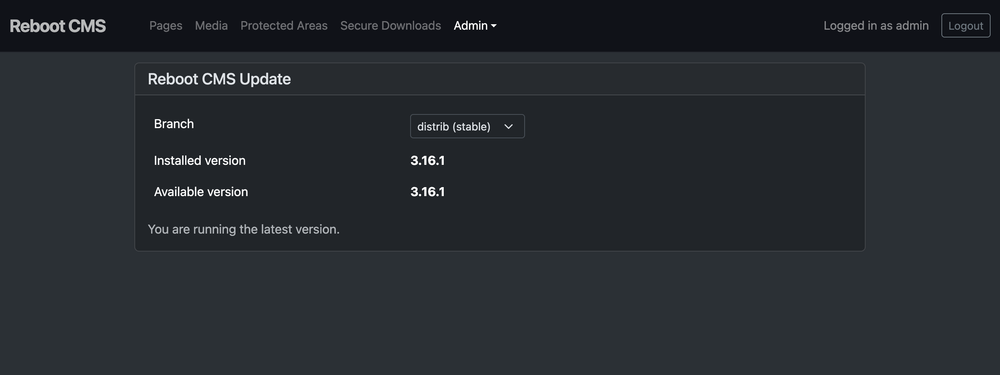

# Reboot CMS

**The Agent-Friendly CMS.**

A flat file, Markdown CMS in PHP, inspired by [Pico](http://picocms.org), [Redaxo](https://redaxo.org/)
and [Craft CMS](https://craftcms.com/).

Reboot CMS is a minimal CMS without a database, but with the support of **blocks** to structure the content.



## Why another CMS?

I developed Reboot CMS because I couldn't find a CMS that works with flat markdown files but allows easy use of blocks.

Reboot CMS is very small and the pages are delivered extremely fast. My website [shaack.com](https://shaack.com), built
with Reboot CMS, has a [PageSpeed Insights performance score of 100](https://pagespeed.web.dev/report?url=https%3A%2F%2Fshaack.com%2F).

## Working with AI agents

Reboot CMS works well with AI coding assistants, because its architecture maps
onto what an agent can reliably reason about:

- **Flat Markdown files, no database** — content is edited directly as text;
  there is no schema, no migrations, and no admin API to learn.
- **File equals URL** — the page for `/about` is always `site/pages/about.md`,
  so an agent locates content without crawling routes.
- **Small, transparent core** — the CMS classes (`Reboot`, `Site`, `Page`,
  `Block`, `Request`) are short enough to fit a model's context window.
- **Blocks are plain PHP files** — a new block type is a single file in
  `site/blocks/`, with no framework or build step in between.
- **Everything is text under Git** — every change is a reviewable diff.

The repository includes an [`AGENTS.md`](AGENTS.md) that orients AI agents
working on a Reboot CMS project.

## Websites using Reboot CMS

- [dsb.shaack.com](https://dsb.shaack.com)
- [shaack.com](https://shaack.com)
- [wukies.de](https://wukies.de)
- [chesscoin032.com](https://chesscoin032.com)
- [The Reboot CMS demo page](https://shaack.com/projekte/reboot-cms/)

## Minimum System Requirements

- **PHP** 8.0 or higher
- **Web Server:** Apache with mod_rewrite (or compatible server)
- **No database required** — all content is stored as flat files

## Install

Clone or download the [Reboot CMS repository](https://github.com/shaack/reboot-cms):

```bash
git clone https://github.com/shaack/reboot-cms.git my-site
```

### Quick Start

Run the CMS in a Podman container with Apache and PHP, the same setup as a typical hosting:

```bash
./run.sh
```

The site is available at `http://localhost:21007`, the admin at `http://localhost:21007/admin`. The script also starts [Mailpit](https://mailpit.axllent.org), a mail catcher, at `http://localhost:25007`, so every mail the CMS sends, for example a login link, shows up there instead of leaving your machine. On the first start the script writes `local/config.local.yml`, which points the CMS at Mailpit and raises the log level. That file is for your machine only and ignored by Git, see [Configuration](#configuration). Other ports: `./run.sh 3000 3025 3080` for HTTP, SMTP and the Mailpit UI.

### Docker / Podman

```bash
cd compose && podman compose up -d
```

The site is available at `http://localhost:8080`.

### Production Setup

Point your web server's document root to the `web/` directory. The CMS should work out of the box.

On first visit to `/admin`, you will be prompted to create an admin account.

## Directory Structure

- `core/src/` — Core CMS classes (Reboot, Site, Page, Block, Request, AddOn)
- `core/addons/` — AddOns shipped with Reboot CMS (`EmailObfuscation`, `LanguageRedirect`, `ProtectedAreas`, `SecureDownloads`)
- `site/` — Site content: `pages/`, `blocks/`, `addons/`, `template.php`, `config.yml`
- `web/` — Document root (`index.php`, `.htaccess`)
- `local/` — Local environment config (`config.yml`, `.htpasswd`) — not in git
- `core/admin/` — Admin interface (itself a Reboot CMS site)
- `web/admin/vendor/` — The browser libraries of the admin (Bootstrap, the Markdown editor), copied from `node_modules/` by `web/admin/build-vendor.sh`. Only this folder is committed and shipped, `npm install` in `web/admin/` is needed just to update those libraries.

## Configuration

- `site/config.yml` — Site-wide settings: addon registration, navbar with `brand` and `structure`,
  and multilingual settings (see [Multilingual sites](#multilingual-sites))
- `local/config.yml` — Settings of the installation: log level, editor, mail. The file ships with the CMS, so an installation runs out of the box, and is edited on the server.
- `local/config.local.yml` — Optional, settings for one machine only, laid over `config.yml`. Sections are merged key by key, so a `mail` section here replaces only the keys it names, lists are replaced as a whole. The file is ignored by Git, `run.sh` writes one for development, and the health page shows which keys it overrides.

The shipped `local/config.yml`:

```yaml
# Logging: 0 = debug, 1 = info, 2 = error
logLevel: 2

# Print PHP notices, warnings and fatals into the page.
# Omit it and the log level decides: on in debug mode (0), off otherwise.
# Keep it off in production, a diagnostic message in the page body discloses the server path.
# displayErrors: false

# Admin editor settings
editor:
  font: 'ui-monospace, SFMono-Regular, "SF Mono", Menlo, Consolas, monospace'
  fontSize: '0.95rem'
  lineHeight: '1.4'
  tabSize: 4
  wordWrap: true
  tools:
    - Headings
    - "|"
    - Bold
    - Italic
    - Strikethrough
    - "|"
    - UnorderedList
    - OrderedList
    - "|"
    - InsertLink
    - InsertImage

# Page history: number of snapshots to keep per page
history:
  maxVersions: 50

# Mail (optional): lets AddOns send mail, see "Sending mail" below
mail:
  transport: smtp           # smtp, mail (PHP mail()) or log (nothing is sent)
  host: mail.example.com
  port: 465
  encryption: ssl           # ssl (465), tls (STARTTLS, 587) or none
  username: noreply@example.com
  password: "secret"
  from: noreply@example.com
  fromName: "Example Inc."
```

### Sending mail

Reboot CMS sends no mail by itself, but AddOns do, for example login links or form submissions. The `mail` section of `local/config.yml` configures how. The recommended transport is `smtp` with a mailbox of your hosting, because mail from an authenticated mailbox passes SPF and DKIM checks and lands in the inbox. `mail` uses PHP's `mail()` without a mailbox, `log` writes the mail to the log instead of sending it, which is handy during development. The credentials belong to the server, not to the site, which is why they live in `local/` and not in `site/config.yml`.

The admin's System Health page shows the mail configuration and sends a test mail on request. Sending is done by [PHPMailer](https://github.com/PHPMailer/PHPMailer).

Available editor tools: `Headings`, `Bold`, `Italic`, `Strikethrough`, `UnorderedList`, `OrderedList`,
`InsertLink`, `InsertImage`. Use `"|"` for a separator. The admin tools (`InsertPageLink`, `InsertMedia`,
`InsertBlock`) are always appended automatically.

## Template

The file `site/template.php` is the main HTML template. It receives three variables:

- `$site` — the `Site` object
- `$page` — the `Page` object
- `$request` — the `Request` object

Call `$page->render($request)` to render the page content and `$page->getConfig()` to access the YAML front matter.

## Documentation

### Page

Folder: `/site/pages`

A `Page` can be a **flat Markdown** file, can contain **Blocks** or also can be a **PHP** file.
PHP pages receive the same variables as the template: `$site`, `$page`, and `$request`.

Pages are auto-routed on web-requests:

- `index.md` or `index.php` will be shown on requesting `/`
- `NAME.md` or `NAME.php` will be shown on requesting `/NAME`
- `FOLDER/index.md` (or .php) will be shown on requesting `/FOLDER`
- `FOLDER/NAME.md` (or .php) will be shown on requesting `/FOLDER/NAME`
- `404.md` (or .php) will be used as a custom 404 error page

Example for a Markdown `Page` with `Blocks`:

```markdown
---
title: Reboot CMS
description: Reboot CMS is a flat file CMS, with the support of blocks.
author: shaack.com
---

<!-- hero -->

# Reboot CMS

A flat file, markdown CMS with blocks

---

The main idea is to have a **minimal CMS** without needing a database, but with the support of blocks.

---

[Learn more](documentation)

<!-- text-image -->

## The "text-image" block

The block above is a "hero" block. This one is a "text-image" block. You can define multiple blocks as you need.
[Reboot CMS documentation](documentation)

Shipped with this CMS are some default block types, but it is easy to create your own, if you know some PHP.

---


<!-- three-columns -->

### the

Duis aute **irure** dolor in *reprehenderit* in voluptate velit esse cillum dolore eu fugiat nulla pariatur. Excepteur sint occaecat cupidatat non proident, sunt in culpa qui officia deserunt mollit anim id est.

---

### "three-colums" Block

Ut enim ad minim [veniam](/), quis nostrud exercitation ullamco laboris nisi ut aliquid ex ea commodi consequat. Quis aute iure reprehenderit in voluptate velit esse cillum dolore eu fugiat nulla pariatur.

---

### block

Lorem ipsum dolor sit amet, consectetur adipisicing elit, sed do eiusmod tempor incididunt ut labore et dolore magna aliqua.
```

This `Page` contains 3 `Block` types, "hero", "text-image" and "three-columns". It will render to this:



Blocks can be configured in the block comment. With this configuration, the `text-image`
block allows to display the image to the left side in desktop view.

Markdown files without blocks will render to a flat Markdown page like in every other flat file CMS.

You can define metadata for the page on top of the file in `YAML Front Matter` syntax.

### Multilingual sites

Reboot CMS routes URLs directly to files, so a multilingual site needs no special
routing — you put each language in its own folder under `site/pages/` and prefix
its URLs with the language code.

#### Folder layout

Keep the default language at the root and add a folder per additional language:

```
site/pages/
  index.md          contact.md       <- default language (no prefix)
  de/
    index.md        contact.md       <- German, served under /de/...
```

`/contact` renders `pages/contact.md`, `/de/contact` renders `pages/de/contact.md`.

#### Configuration

Declare the available languages in `site/config.yml`:

```yaml
languages: [en, de]
defaultLanguage: en
```

`languages` lists every language code that may appear as a URL prefix.
`defaultLanguage` is the language used for paths without a prefix — it is
optional and defaults to the first entry of `languages`.

#### Detecting the language

The `Request` object detects the language from the first path segment:

- `$request->getLanguage()` — the current language code (e.g. `"de"`), or the
  default language for unprefixed paths
- `$request->getPathWithoutLanguage()` — the path with the language prefix
  stripped (e.g. `/de/contact` becomes `/contact`), handy for language switchers
  and `hreflang` tags

#### Multilingual navigation

Define one navigation structure per language in `site/config.yml`, so that both
the labels and the target paths are translated:

```yaml
navbar:
  brand: Reboot CMS
  structure:
    en:
      Home: /
      Contact: /contact
    de:
      Start: /de
      Kontakt: /de/contact
```

In `site/template.php`, pick the structure for the current language:

```php
$lang = $request->getLanguage();
$structure = $site->getConfig()['navbar']['structure'][$lang];
foreach ($structure as $label => $path) {
    echo '<a href="' . $site->getWebPath() . $path . '">' . $label . '</a>';
}
```

Build a language switcher by linking to the current page in the other language
with `$request->getPathWithoutLanguage()`. Append a `?setlang=xx` marker so the
`LanguageRedirect` addon (see below) registers the choice:

```php
// link to the German version of the current page
$href = $site->getWebPath() . '/de' . $request->getPathWithoutLanguage() . '?setlang=de';
```

Set the `<html>` language attribute from the detected language as well:

```php
<html lang="<?= $request->getLanguage() ?>">
```

#### Redirecting to the visitor's language

The built-in `LanguageRedirect` AddOn (see its [README](core/addons/LanguageRedirect/README.md)) sends visitors to the language version that matches their preference. Enable it in `site/config.yml`:

```yaml
addons: [ LanguageRedirect ]
```

On the homepage it redirects the visitor to their preferred language. An
explicit choice stored in the `lang` cookie wins, otherwise the browser's
`Accept-Language` header decides. Visitors whose preference is the
`defaultLanguage` are not redirected, and the decision is taken on every visit,
so a visitor whose browser prefers a non-default language consistently lands on
that language.

The `lang` cookie records only an *explicit* choice, which is why switcher
links must carry the `?setlang=xx` marker shown above. When the addon sees
`?setlang`, it stores the choice and redirects to the clean URL, so switching
to the default language keeps the unprefixed homepage reachable instead of
bouncing back.

### Block

Folder: `/site/blocks`

Files in `site/blocks/` whose name starts with an underscore, for example `_helpers.php`, are not blocks but helpers the block templates `require_once`. The admin skips them when it collects block examples, so shared functions can live there without being declared twice.

A block template is also rendered once with empty content when the admin collects the examples for the "Insert Block" menu, so every field may be missing. `nodeHtml()` takes that in stride, an empty list or `null` gives an empty string. If a template still throws, for example by indexing into a node list, the block is replaced by an error box with the message and the rest of the page, editor included, keeps working. The error is logged as well.

A `Block` describes how a block is rendered. Blocks are written in PHP.

The code for the "text-image" `Block` which was used in the page above, looks like this:

```php
<?php
// read the configuration
$imagePosition = @$block->getConfig()["image-position"];
?>
<section class="block block-text-image">
    <div class="container-fluid">
        <div class="row">
            <div class="col-md-6 <?= $imagePosition === "left" ? "order-md-1" : "" ?>">
                <!-- all text from part 1 (xpath statement) -->
                <?= $block->nodeHtml($block->xpath("/*[part(1)]")) ?>
            </div>
            <div class="col-md-6">
                <!-- using attributes of the image in part 2 -->
                nodeHtml($block->xpath("//img[part(2)]/@src")) ?>"
                     alt="<?= $block->nodeHtml($block->xpath("//img[part(2)]/@alt")) ?>"
                     title="<?= $block->nodeHtml($block->xpath("//img[part(2)]/@title")) ?>"/>
            </div>
        </div>
    </div>
</section>
```

Elements in the markdown are queried and used as values for the block. The query syntax
is [Xpath](https://devhints.io/xpath) with the addition of the `part(n)` function.

Use `$block->content()` to get the full block content as rendered HTML (without XPath querying).
This is useful for simple blocks like "text":

```php
<section class="block block-text">
    <div class="container-fluid">
        <?= $block->content() ?>
    </div>
</section>
```

### Schema validation

`$block->xpath()` accepts an optional second parameter — an array of props for validation:

| Prop | Type | Description |
|------|------|-------------|
| `required` | `bool` | Field must match at least once |
| `description` | `string` | Human-readable name, shown in validation warnings |
| `min` | `int` | Minimum number of matches required (for lists) |
| `max` | `int` | Maximum number of matches allowed (for lists) |

When a required field is missing or a minimum count is not met, the CMS logs an error and — in
debug mode (`logLevel: 0`) — shows a warning banner on the page and a toast with the expected
markdown structure in the admin editor.

Example — the "hero" block with validation:

```php
<?php /** @var \Shaack\Reboot\Block $block */ ?>
<section class="block block-hero">
    <div class="container-fluid">
        <div class="card border-0 bg-gradient">
            <div class="card-body">
                <div class="p-xl-5 p-md-4 p-3">
                    <h1 class="display-4"><?= $block->nodeHtml($block->xpath("/h1[part(1)]/text()", ["required" => true, "description" => "Hero heading (h1)"])) ?></h1>
                    <p class="lead"><?= $block->nodeHtml($block->xpath("/p[part(1)]/text()")) ?></p>
                    <hr class="my-4">
                    <div class="mb-4">
                        <?= $block->nodeHtml($block->xpath("/*[part(2)]")) ?>
                    </div>
                    <p>
                        <a class="btn btn-primary btn-lg"
                           href="<?= $block->nodeHtml($block->xpath("//a[part(3)]/@href", ["required" => true, "description" => "Call-to-action link"])) ?>"
                           role="button"><?= $block->nodeHtml($block->xpath("//a[part(3)]/text()")) ?></a>
                    </p>
                </div>
            </div>
        </div>
    </div>
</section>
```

For list fields (like the "cards" block), use `min` to require a minimum number of matches:

```php
$images = $block->xpath("//li/img", ["min" => 1, "description" => "Card images"]);
```

## Admin interface

You find the admin interface at `/admin`.

If no users exist yet (e.g. on a fresh installation), the admin interface will automatically show a setup page where
you can create the first admin account. After that, you can log in with the credentials you created.

In the admin interface you can edit markdown pages with a live preview, manage media files, set the site
configuration, manage users and roles, and update the CMS.

### Edit a page

The "Pages" section lists all markdown pages in your site. Click on a page name to open it in the editor.
Pages are organized in a tree structure reflecting the folder hierarchy in `site/pages/`.

A **live preview** panel can be toggled to see the rendered page side-by-side with the editor
(available on screens lg and wider). The preview updates automatically as you type.

The editor tracks **page history** — every save creates a snapshot. You can view previous versions and
restore them from the History dialog. The number of snapshots kept per page is configurable via
`history.maxVersions` in `local/config.yml`.


### Media

The "Media" section lets you manage files in the `web/media/` directory. You can upload files, create folders,
and delete files or empty folders. Media files are accessible at `/media/` in the browser and can be referenced
in your markdown pages.



### Secure Downloads

The "Secure Downloads" section hands out single files through cryptic, short lived links that are additionally protected by a six digit password. It is meant for sending a document to one recipient, not for public files. Those belong in "Media".

Upload a file and Reboot CMS creates a link plus a password:

```
https://example.com/downloads/3ef938314c4d6cfe.pdf
Password: 692072
```

The real file name never appears in the link. The extension is cosmetic, the name is only sent in the `Content-Disposition` header, so the recipient still saves the file as `Passwords.pdf`. Send the link by mail and the password through another channel, then neither message alone is enough to open the file.

The list shows for every download whether it was fetched already, when, and from which anonymized IP address. The optional note you enter when uploading is shown to the recipient above the password form, so they know what they are about to download without the file name being revealed.

A link expires **one week after the upload**, or **one hour after the first download**, whichever comes first. Within that hour the file may be fetched again, so an interrupted transfer does not ruin the link. After expiry the file is deleted from the server automatically; the entry stays in the list for 30 days, so the log remains readable. Ten wrong passwords lock a link for good, which is what keeps six digits from being guessable.

Files live in `local/downloads/`, outside the web root and behind `local/.htaccess`, so nothing is ever served by the web server directly. Only the `SecureDownloads` addon delivers a file, and only after the password was accepted. The password is stored in plain text next to the file, which is what makes it readable in the admin list later.

The whole feature is the built-in `SecureDownloads` AddOn (see its [README](core/addons/SecureDownloads/README.md)). Add it to `site/config.yml`:

```yaml
addons: [ SecureDownloads ]
```

This enables the delivery of the files and mounts the "Secure Downloads" section in the admin. Without the AddOn there is neither a menu entry nor an admin page.

The defaults need no configuration. All values can be changed per site:

```yaml
secureDownloads:
  path: /downloads        # URL prefix of the links
  linkLifetime: 604800    # seconds a fresh link stays valid (one week)
  downloadWindow: 3600    # seconds after the first download (one hour)
  logRetention: 2592000   # seconds an expired entry stays in the list (30 days)
  texts:                  # override the built-in texts, per language
    de:
      title: "Datei herunterladen"
      intro: "Bitte geben Sie das Passwort ein, das Sie per SMS erhalten haben."
```

The download page is self contained and does not use the site template, so a link looks the same in every project. Its texts ship in English and German and follow the request language on multilingual sites, so `/de/downloads/3ef938314c4d6cfe.pdf` speaks German.

The upload size is limited by PHP, not by Reboot CMS. The current limits are shown next to the upload field; raise `upload_max_filesize` and `post_max_size` in `php.ini` for larger files.

### Site configuration

In the site configuration, you can store global values of the site, like the navigation structure or the content of
header elements. The site configuration is written in YAML.



### User management

The "Users" page in the admin interface allows you to manage accounts directly from the browser. You can:

- **Add users** — create new accounts with a username, password, and role
- **Change passwords** — update the password for any existing user
- **Change roles** — switch a user between the **Admin**, **Editor**, and **Disabled** roles
- **Delete users** — remove accounts (you cannot delete your own account)

**Admins** have full access to all admin pages. **Editors** can only access the page editor and media manager.
**Disabled** users keep their account but cannot log in; an open session is ended on the next request.

Usernames may contain letters, numbers, and underscores (max 64 characters). Passwords must be at least 8 characters.
Credentials are stored as APR1-MD5 hashes in `local/.htpasswd`, roles in `local/roles.yml`.

### Stay signed in

The login form offers "Stay signed in for 2 weeks". Without it the login lasts as long as the browser session. With it, Reboot CMS sets a second cookie with a random token that restores the session for two weeks, for example after a restart of the browser. Only a hash of the token is stored, in `local/remember-tokens.json`, and every token is good for one use, the next visit replaces it. Logging out, changing the password, disabling or deleting the account forgets the tokens of that user.



You can also manage users via the command line:

```sh
cd local
htpasswd .htpasswd admin
```

### Backup

The "Backup" page writes a zip archive of the content, that is `site/` with pages, blocks and configuration, plus the
uploaded files in `web/media/`. The CMS itself (`core/`, `vendor/`, `web/admin/`) is not included, it comes from the
release, and neither is `local/` with the configuration, the accounts and the archives themselves.

An archive is named after the site and the moment it was written, for example
`Backup_example.com_2026-10-19_1148.zip`. The page lists the existing archives with size and date, and offers download
and delete for each. The files live in `local/backups/`, outside the document root, so they are only reachable through
the admin page and never over a direct URL.

The page needs the PHP extension `zip`. Without it the button stays disabled and the page says so, and the System
Health page lists the extension as missing. The development container of `run.sh` ships without `zip`, so backups are
a thing to try on a server.

A backup restores by unpacking the archive over the project root, the paths inside match the project layout.

### Update

The "Update" page in the admin interface shows the currently installed version and checks for available updates from
the [GitHub repository](https://github.com/shaack/reboot-cms).

You can switch between two branches:

- **distrib** (stable) — versioned releases, compared by version number
- **main** (unstable) — latest development commits, compared by commit SHA

When an update is available, you can apply it directly from the admin interface. The updater downloads the latest
tarball and replaces `core/`, `web/admin/`, and `vendor/`. Your site content (`site/`), local configuration (`local/`),
and entry point (`web/index.php`) are not affected.

It is recommended to make a backup of the project folder before updating.



## Built-in AddOns

Some features of Reboot CMS are not part of the core but ship as AddOns in `core/addons/`. They are off by default and switched on per site by listing them under `addons` in `site/config.yml`:

```yaml
addons: [ LanguageRedirect, EmailObfuscation, SecureDownloads, ProtectedAreas ]
```

Everything an AddOn needs is in its folder, including its admin pages, so an AddOn that is not listed leaves no trace in the admin. Because `core/` is replaced by the [updater](#update), the built-in AddOns are updated together with the CMS. A project can still override one by placing an AddOn of the same name in `site/addons/`.

Each AddOn folder has a `README.md` with the complete documentation of that AddOn.

### LanguageRedirect

Sends visitors of a multilingual site to the language version matching their preference. On the homepage an explicit choice stored in the `lang` cookie wins, otherwise the browser's `Accept-Language` header decides, and visitors who prefer the default language are not redirected. A language switcher appends `?setlang=xx` to register the visitor's choice. The AddOn does nothing on a site with a single language.

See the [LanguageRedirect README](core/addons/LanguageRedirect/README.md) and [Multilingual sites](#multilingual-sites).

### EmailObfuscation

Hides e-mail addresses from harvesters. After a page has been rendered, every `mailto:` link and every address in the visible text is replaced by a small inline script that writes the original markup back into the page. Visitors see the address as before, a crawler without JavaScript sees only base64. Nothing to configure.

See the [EmailObfuscation README](core/addons/EmailObfuscation/README.md).

### SecureDownloads

Hands out single files through cryptic, short lived links that are additionally protected by a six digit password, for sending a document to one recipient. Files are uploaded in the admin section "Secure Downloads", which the AddOn brings along. A link expires one week after the upload or one hour after the first download, ten wrong passwords lock it, and expired files are deleted automatically. Files live in `local/downloads/`, outside the web root.

See the [SecureDownloads README](core/addons/SecureDownloads/README.md) and the admin section [Secure Downloads](#secure-downloads). The AddOn was called `Downloads` before, the old name still works as a deprecated alias.

### ProtectedAreas

Puts parts of the site behind a login. A protected area is a path prefix such as `/customers`, and every page below it is served only to a logged in user whose account lists a matching path, for example `/customers/acme`. Accounts are e-mail addresses. The AddOn brings a login page rendered inside the site template, a logout URL, a limit on failed logins and the admin section "Protected Areas" for the accounts. If the site can [send mail](#sending-mail), visitors can also request a login link by mail instead of typing a password, and stay logged in for 30 days. What the protected pages contain is up to the site, so a customer area is just a folder of Markdown pages that you edit like any other.

```yaml
addons: [ ProtectedAreas ]
protectedAreas:
  areas: [ /customers ]
```

See the [ProtectedAreas README](core/addons/ProtectedAreas/README.md).

## AddOns

In Reboot CMS you can extend the functionality of your site with **AddOns**. AddOns hook into the request lifecycle to add authentication, modify rendered content, inject headers, track analytics, or implement any custom logic. An AddOn can also bring its own pages to the admin, so a feature like [Secure Downloads](#secure-downloads) is one self-contained unit.

### Creating an AddOn

An AddOn is a folder in `site/addons/`, named after its class. The class file sits at the top level and extends [`AddOn`](core/src/Shaack/Reboot/AddOn.php), everything else is optional:

```
site/addons/MyAddOn/
  MyAddOn.php          # the AddOn class, namespace Shaack\Reboot\AddOns
  src/                 # helper classes, namespace Shaack\Reboot\AddOns\MyAddOn\, autoloaded
  admin/               # admin pages, mounted at /admin/myaddon (see below)
```

```php
<?php
// site/addons/MyAddOn/MyAddOn.php

namespace Shaack\Reboot\AddOns;

use Shaack\Logger;
use Shaack\Reboot\AddOn;
use Shaack\Reboot\Request;

class MyAddOn extends AddOn
{
    protected function init()
    {
        // Called once when the AddOn is loaded
        Logger::info("MyAddOn initialized");
    }

    public function preRender(Request $request): bool
    {
        // Called before page rendering
        // Return true to continue, false to stop (e.g. after a redirect)
        return true;
    }

    public function postRender(Request $request, string $content): string
    {
        // Called after page rendering, can modify the HTML output
        return $content;
    }
}
```

A helper class in `src/Util/Helper.php` is available as `Shaack\Reboot\AddOns\MyAddOn\Util\Helper` without any registration.

The former single file format, `site/addons/MyAddOn.php` with the class in the namespace `Shaack\Reboot`, still works but is **deprecated**. Such AddOns cannot bring admin pages or helper classes, and the admin's System Health page lists them. To migrate, move the file into a folder of the same name and change the namespace to `Shaack\Reboot\AddOns`.

### Registering AddOns

Register your AddOns in `site/config.yml`. They are loaded and executed in the order listed:

```yml
addons: [ MyAddOn, AnotherAddOn ]
```

### Using the built-in AddOns

The AddOns shipped in `core/addons/` need no folder in `site/addons/`, just list them in `addons`. They are described in [Built-in AddOns](#built-in-addons), each has a `README.md` in its folder, which is the convention for your own AddOns as well. An AddOn of the same name in `site/addons/` takes precedence over the built-in one, so you can still override it per site.

### Admin Pages

An AddOn adds pages to the admin by putting PHP files into its `admin/` folder. The folder is mounted at the AddOn's admin path, which is its lower case name by default:

```
site/addons/MyAddOn/admin/index.php      → /admin/myaddon
site/addons/MyAddOn/admin/log.php        → /admin/myaddon/log
site/addons/MyAddOn/admin/api/list.php   → /admin/myaddon/api/list
```

An `admin/index.php` also adds a menu entry named after the AddOn to the admin navigation. Pages and menu entry exist only while the AddOn is listed in `site/config.yml`, so disabling an AddOn removes its admin section as well. The pages are rendered inside the admin template with `$reboot`, `$site` (the admin site), `$page` and `$request` available, like the built-in admin pages. Start every page with the admin role check, and reach your AddOn through the admin's view of the site:

```php
<?php
use Shaack\Reboot\AddOns\Admin\AdminHelper;

if (!AdminHelper::requireAdmin($site, $reboot)) return;

$myAddOn = $site->getAddOn("Admin")->getDefaultSite()->getAddOn("MyAddOn");
```

Three methods let you deviate from the convention:

- `getAdminPath(): string` — the mount point, `/myaddon` by default.
- `getAdminPages(): array` — the pages as `path => PHP file`, by default the content of `admin/`.
- `getAdminMenu(): array` — the navigation entries as `label => path`. By default one entry for `admin/index.php`. Return `[]` to keep a page out of the menu, or a nested array to extend a dropdown: `['Admin' => ['Statistics' => '/myaddon']]` adds the page to the "Admin" menu. AddOn entries are shown to admins only and never override a built-in entry of the same name.

See [core/addons/SecureDownloads/](core/addons/SecureDownloads/) for a complete AddOn with a frontend part, a helper class and an admin page.

### Available Properties

Inside your AddOn, you have access to:

- `$this->reboot` — the [`Reboot`](core/src/Shaack/Reboot/Reboot.php) instance (base paths, config, redirects)
- `$this->site` — the [`Site`](core/src/Shaack/Reboot/Site.php) instance (site config, paths, other addons)
- `$this->dir` — the folder of the AddOn, `null` for the deprecated single file format
- `$this->reboot->getMailer()` — the [`Mailer`](core/src/Shaack/Reboot/Mailer.php), configured in `local/config.yml` (see [Sending mail](#sending-mail)). Check `isConfigured()` if mail is optional for your AddOn, `send()` throws a `RuntimeException` when a mail cannot be handed over:

```php
$mailer = $this->reboot->getMailer();
if ($mailer->isConfigured()) {
    $mailer->send('alice@example.com', 'Your login link', "Open this link: $url", ['toName' => 'Alice']);
}
```

### Lifecycle Hooks

#### `init(): void`

Called once after construction of the AddOn. Use this to initialize data, read configurations, or start sessions.

#### `preRender(Request $request): bool`

Called on every request before rendering the page. Use it to:

- **Control access** — check authentication and redirect unauthorized users
- **Modify request handling** — perform redirects based on request path or parameters

Return `true` to continue rendering the page, or `false` to stop (e.g. after calling `$this->reboot->redirect()`).

#### `postRender(Request $request, string $content): string`

Called after the page is rendered, before the output is sent to the browser. Use it to:

- **Modify HTML output** — inject scripts, stylesheets, or meta tags
- **Add tracking** — append analytics snippets
- **Transform content** — search and replace patterns in the rendered HTML

Returns the (possibly modified) content string.

#### `getPages(): array`

Pages the AddOn adds to its own site, as `path => PHP file`, for example `['/sitemap.xml' => $this->dir . '/pages/sitemap.php']`. A page is rendered like a PHP page in `site/pages/`, and a file in `site/pages/` of the same path wins. Admin pages use the `admin/` folder instead, see [Admin Pages](#admin-pages).

### Accessing AddOns from Pages

You can access a registered AddOn from any page template using:

```php
$myAddOn = $site->getAddOn("MyAddOn");
```

### Examples

See the included [ExampleAddOn](site/addons/ExampleAddOn/README.md) for a basic implementation and [SecureDownloads](core/addons/SecureDownloads/README.md) for a complete one. The admin interface is itself a Reboot CMS site and uses AddOns too: [Authentication](core/admin/addons/Authentication/Authentication.php) for login session handling and [Admin](core/admin/addons/Admin/Admin.php) for the bridge to the managed site, which also mounts the admin pages of its AddOns.